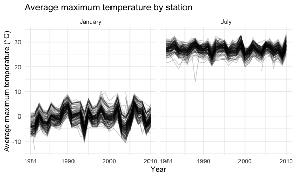
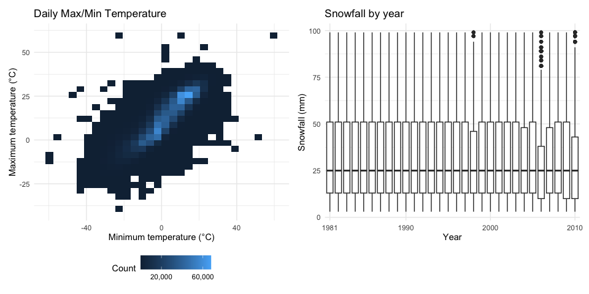
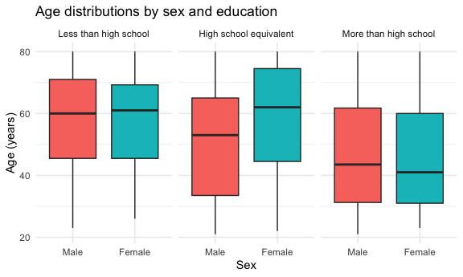
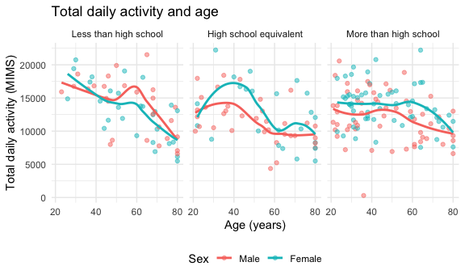
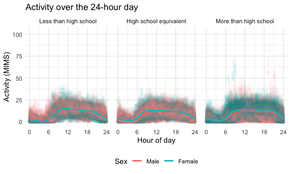
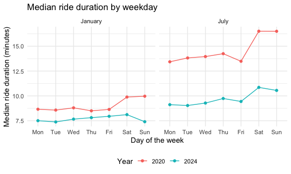
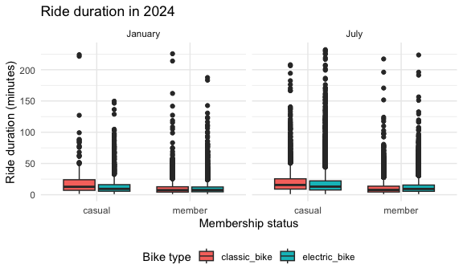

p8105_hw3_hs3653
================
Hyder Said
2026-10-18

# Problem 1

``` r
data("ny_noaa")
ny_noaa
```

    ## # A tibble: 2,595,176 × 7
    ##    id          date        prcp  snow  snwd tmax  tmin 
    ##    <chr>       <date>     <int> <int> <int> <chr> <chr>
    ##  1 US1NYAB0001 2007-11-01    NA    NA    NA <NA>  <NA> 
    ##  2 US1NYAB0001 2007-11-02    NA    NA    NA <NA>  <NA> 
    ##  3 US1NYAB0001 2007-11-03    NA    NA    NA <NA>  <NA> 
    ##  4 US1NYAB0001 2007-11-04    NA    NA    NA <NA>  <NA> 
    ##  5 US1NYAB0001 2007-11-05    NA    NA    NA <NA>  <NA> 
    ##  6 US1NYAB0001 2007-11-06    NA    NA    NA <NA>  <NA> 
    ##  7 US1NYAB0001 2007-11-07    NA    NA    NA <NA>  <NA> 
    ##  8 US1NYAB0001 2007-11-08    NA    NA    NA <NA>  <NA> 
    ##  9 US1NYAB0001 2007-11-09    NA    NA    NA <NA>  <NA> 
    ## 10 US1NYAB0001 2007-11-10    NA    NA    NA <NA>  <NA> 
    ## # ℹ 2,595,166 more rows

``` r
ny_noaa |>
  summarize(
    n_stations = n_distinct(id),
    first_date = min(date),
    last_date = max(date)
  )
```

    ## # A tibble: 1 × 3
    ##   n_stations first_date last_date 
    ##        <int> <date>     <date>    
    ## 1        747 1981-01-01 2010-12-31

``` r
ny_noaa |>
  summarize(
    missing_prcp = sum(is.na(prcp)),
    missing_snow = sum(is.na(snow)),
    missing_snwd = sum(is.na(snwd)),
    missing_tmax = sum(is.na(tmax)),
    missing_tmin = sum(is.na(tmin))
  )
```

    ## # A tibble: 1 × 5
    ##   missing_prcp missing_snow missing_snwd missing_tmax missing_tmin
    ##          <int>        <int>        <int>        <int>        <int>
    ## 1       145838       381221       591786      1134358      1134420

The NY NOAA dataset contains 2,595,176 daily observations from 747
weather stations, spanning January 1, 1981, through December 31, 2010.
The seven variables include station ID, date, precipitation, snowfall,
snow depth, and maximum and minimum temperatures. Missing data are
common, particularly for temperature. Overall, 5.6% of precipitation,
14.7% of snowfall, 22.8% of snow depth, and 43.7% of maximum and minimum
temperature observations are missing.

``` r
noaa_df =
  ny_noaa |>
  separate(
    date,
    into = c("year", "month", "day"),
    sep = "-"
  ) |>
  mutate(
    tmax = as.numeric(tmax) / 10,
    tmin = as.numeric(tmin) / 10,
    prcp = prcp / 10
  )
```

## Snow Fall

``` r
noaa_df |>
  count(snow, sort = TRUE)
```

    ## # A tibble: 282 × 2
    ##     snow       n
    ##    <int>   <int>
    ##  1     0 2008508
    ##  2    NA  381221
    ##  3    25   31022
    ##  4    13   23095
    ##  5    51   18274
    ##  6    76   10173
    ##  7     8    9962
    ##  8     5    9748
    ##  9    38    9197
    ## 10     3    8790
    ## # ℹ 272 more rows

The most commonly observed snowfall value is 0 mm, reflecting that most
days have no snowfall. The most frequent positive values are 25, 13, and
51 mm. These are approximately equivalent to 1, 0.5, and 2 inches,
suggesting that measurements were originally recorded in rounded inch
increments and then converted to millimeters.

## Temperature

``` r
temperature_df =
  noaa_df |>
  filter(month %in% c("01", "07")) |>
  group_by(id, year, month) |>
  summarize(
    mean_tmax = mean(tmax, na.rm = TRUE)
  ) |>
  ungroup() |>
  drop_na(mean_tmax)
```

    ## `summarise()` has regrouped the output.
    ## ℹ Summaries were computed grouped by id, year, and month.
    ## ℹ Output is grouped by id and year.
    ## ℹ Use `summarise(.groups = "drop_last")` to silence this message.
    ## ℹ Use `summarise(.by = c(id, year, month))` for per-operation grouping
    ##   (`?dplyr::dplyr_by`) instead.

``` r
temperature_df |>
  mutate(
    year = as.numeric(year),
    month = factor(
      month,
      levels = c("01", "07"),
      labels = c("January", "July")
    )
  ) |>
  ggplot(aes(x = year, y = mean_tmax, group = id)) +
  geom_line(alpha = .2) +
  facet_grid(~ month) +
  scale_x_continuous(
    breaks = c(1981, 1990, 2000, 2010)
  ) +
  labs(
    title = "Average maximum temperature by station",
    x = "Year",
    y = "Average maximum temperature (°C)"
  )
```



``` r
temperature_df |>
  filter(month == "07", mean_tmax < 15)
```

    ## # A tibble: 1 × 4
    ##   id          year  month mean_tmax
    ##   <chr>       <chr> <chr>     <dbl>
    ## 1 USC00308962 1988  07         14.0

``` r
noaa_df |>
  filter(id == "USC00308962", year == "1988", month == "07") |>
  drop_na(tmax) |>
  summarize(
    observed_days = n(),
    mean_tmax = mean(tmax),
    min_tmax = min(tmax),
    max_tmax = max(tmax)
  )
```

    ## # A tibble: 1 × 4
    ##   observed_days mean_tmax min_tmax max_tmax
    ##           <int>     <dbl>    <dbl>    <dbl>
    ## 1            31      14.0      8.3     20.6

The average maximum temperatures are consistently higher in July than in
January. January shows greater variation between years, while stations
generally follow similar annual patterns within each month. One notable
outlier is station USC00308962 in July 1988, which had an average
maximum temperature of 14C. This does not appear to be due to
missingness, as all 31 days had reported maximum temperatures, ranging
from 8.3C to 20.6C. Further investigation would be needed to determine
whether this reflects actual weather conditions or a recording issue.

## Temperature Maximum/Minimum Plots

``` r
temperature_plot =
  noaa_df |>
  drop_na(tmin, tmax) |>
  ggplot(aes(x = tmin, y = tmax)) +
  geom_bin2d() +
  scale_fill_continuous(
    breaks = c(20000, 60000),
    labels = c("20,000", "60,000")
  ) +
  labs(
    title = "Daily Max/Min Temperature",
    x = "Minimum temperature (°C)",
    y = "Maximum temperature (°C)",
    fill = "Count"
  )

snowfall_plot =
  noaa_df |>
  filter(snow > 0, snow < 100) |>
  ggplot(aes(x = year, y = snow)) +
  geom_boxplot() +
  scale_x_discrete(
    breaks = c("1981", "1990", "2000", "2010")
  ) +
  labs(
    title = "Snowfall by year",
    x = "Year",
    y = "Snowfall (mm)"
  )

temperature_plot + snowfall_plot
```

    ## `stat_bin2d()` using `bins = 30`. Pick better value `binwidth`.



Daily maximum and minimum temperatures show a strong positive
relationship, with some isolated potential outliers away from the main
cluster. Among snowfall observations greater than 0 and less than 100
mm, distributions are fairly similar across years, with medians around
25 mm and right-skewed distributions. Potential snowfall outliers appear
in the early 2000s - 2010, with values roughly between 80 and 100 mm.
Overall, the typical snowfall amount appears relatively stable across
years.

# Problem 2

## Data Preparation

Participants younger than 21 years and those missing demographic
information were excluded, leaving 228 participants. Sex and education
were encoded as factors. Accelerometer data were reshaped to one row per
participant per minute and joined to demographic data using participant
ID, retaining all originally observed information.

``` r
# Load and Clean Data
covar_df =
  read_csv("./data/nhanes_covar.csv", skip = 4) |>
  janitor::clean_names() |>
  filter(age >= 21) |>
  drop_na(sex, age, bmi, education) |>
  mutate(
    sex = factor(
      sex,
      levels = c(1, 2),
      labels = c("Male", "Female")
    ),
    education = factor(
      education,
      levels = c(1, 2, 3),
      labels = c(
        "Less than high school",
        "High school equivalent",
        "More than high school"
      )
    )
  )
```

    ## Rows: 250 Columns: 5
    ## ── Column specification ────────────────────────────────────────────────────────
    ## Delimiter: ","
    ## dbl (5): SEQN, sex, age, BMI, education
    ## 
    ## ℹ Use `spec()` to retrieve the full column specification for this data.
    ## ℹ Specify the column types or set `show_col_types = FALSE` to quiet this message.

``` r
accel_df =
  read_csv("./data/nhanes_accel.csv") |>
  janitor::clean_names() |>
  pivot_longer(
    min1:min1440,
    names_to = "minute",
    names_prefix = "min",
    values_to = "mims"
  ) |>
  mutate(
    minute = as.numeric(minute)
  )
```

    ## Rows: 250 Columns: 1441
    ## ── Column specification ────────────────────────────────────────────────────────
    ## Delimiter: ","
    ## dbl (1441): SEQN, min1, min2, min3, min4, min5, min6, min7, min8, min9, min1...
    ## 
    ## ℹ Use `spec()` to retrieve the full column specification for this data.
    ## ℹ Specify the column types or set `show_col_types = FALSE` to quiet this message.

``` r
nhanes_df =
  left_join(covar_df, accel_df, by = "seqn")

nhanes_df
```

    ## # A tibble: 328,320 × 7
    ##     seqn sex     age   bmi education              minute  mims
    ##    <dbl> <fct> <dbl> <dbl> <fct>                   <dbl> <dbl>
    ##  1 62161 Male     22  23.3 High school equivalent      1 1.11 
    ##  2 62161 Male     22  23.3 High school equivalent      2 3.12 
    ##  3 62161 Male     22  23.3 High school equivalent      3 1.47 
    ##  4 62161 Male     22  23.3 High school equivalent      4 0.938
    ##  5 62161 Male     22  23.3 High school equivalent      5 1.60 
    ##  6 62161 Male     22  23.3 High school equivalent      6 0.145
    ##  7 62161 Male     22  23.3 High school equivalent      7 2.10 
    ##  8 62161 Male     22  23.3 High school equivalent      8 0.509
    ##  9 62161 Male     22  23.3 High school equivalent      9 1.63 
    ## 10 62161 Male     22  23.3 High school equivalent     10 1.20 
    ## # ℹ 328,310 more rows

``` r
covar_df |>
  count(education, sex) |>
  pivot_wider(
    names_from = sex,
    values_from = n
  ) |>
  knitr::kable(
    col.names = c("Education", "Men", "Women")
  )
```

| Education              | Men | Women |
|:-----------------------|----:|------:|
| Less than high school  |  27 |    28 |
| High school equivalent |  35 |    23 |
| More than high school  |  56 |    59 |

The largest education group is those with more than a high school
education (56 men, 59 women, 115 total). Numbers of men and women are
similar within this group and among those with less than a high school
education. Among those with a high school equivalent education, there
are more men (35) than women (23).

## Age Distribution Plot

``` r
covar_df |>
  ggplot(aes(x = sex, y = age, fill = sex)) +
  geom_boxplot() +
  facet_grid(~ education) +
  labs(
    title = "Age distributions by sex and education",
    x = "Sex",
    y = "Age (years)"
  ) +
  theme(legend.position = "none")
```



Participants with more than a high school education tend to be younger,
with median ages in the early 40s for both men and women. Among those
with less than a high school education, median ages are around 60 years
for both men and women. In the high school equivalent group, women have
a higher median age than men, approximately 62 versus 53 years,
respectively. Age distributions overlap across all groups.

## Total Daily Activity Versus Age Plot

``` r
total_activity_df =
  nhanes_df |>
  group_by(seqn, sex, age, bmi, education) |>
  summarize(
    total_activity = sum(mims)
  ) |>
  ungroup()
```

    ## `summarise()` has regrouped the output.
    ## ℹ Summaries were computed grouped by seqn, sex, age, bmi, and education.
    ## ℹ Output is grouped by seqn, sex, age, and bmi.
    ## ℹ Use `summarise(.groups = "drop_last")` to silence this message.
    ## ℹ Use `summarise(.by = c(seqn, sex, age, bmi, education))` for per-operation
    ##   grouping (`?dplyr::dplyr_by`) instead.

``` r
total_activity_df |>
  ggplot(aes(x = age, y = total_activity, color = sex)) +
  geom_point(alpha = .5) +
  geom_smooth(se = FALSE) +
  facet_grid(~ education) +
  labs(
    title = "Total daily activity and age",
    x = "Age (years)",
    y = "Total daily activity (MIMS)",
    color = "Sex"
  )
```

    ## `geom_smooth()` using method = 'loess' and formula = 'y ~ x'



Total daily activity generally decreases with age across education
groups, although there is quite a bit of variation among participants of
similar ages. Women tend to have higher activity than men across much of
adulthood in those with a high school equivalent or more than high
school education. This difference is less consistent among those with
less than a high school education. At older ages (60+), the curves tend
to converge toward lower overall activity. There appear to be some
potential outliers, especially the man in his late 30s with more than a
high school education who had very low total daily activity, nearly
zero.

## Activity Over 24-Hour Day

``` r
activity_time_df =
  nhanes_df |>
  mutate(
    hour = (minute - 1) / 60
  )

activity_time_df |>
  ggplot(aes(x = hour, y = mims, color = sex)) +
  geom_point(alpha = .01) +
  geom_smooth(se = FALSE) +
  facet_grid(~ education) +
  scale_x_continuous(
    breaks = c(0, 6, 12, 18, 24),
    limits = c(0, 24)
  ) +
  labs(
    title = "Activity over the 24-hour day",
    x = "Hour of day",
    y = "Activity (MIMS)",
    color = "Sex"
  )
```

    ## `geom_smooth()` using method = 'gam' and formula = 'y ~ s(x, bs = "cs")'



Activity follows a similar pattern across education groups, with a
trough overnight, a sharp increase in the morning, and a decline in the
evening. Women tend to have slightly higher daytime activity among those
with more than a high school education, while sex differences are
smaller in the other groups. Peaks also differ across education groups,
with a higher late-morning peak in the smoothed trends among those with
less than a high school education, followed by a steady decline.
Meanwhile, those with a high school equivalent or more than a high
school education maintain a fairly stable daytime plateau until
approximately 6-8 PM before declining. There is considerable variation
in minute-level activity, with some particularly high values among those
with more than a high school education, including high values around 8-9
AM and 7-8 PM. These may reflect brief periods of intense activity
rather than recording errors.

# Problem 3

## Data Preparation

``` r
# Import
jan_2020_df =
  read_csv("./data/citibike/Jan 2020 Citi.csv") |>
  janitor::clean_names()
```

    ## Rows: 12420 Columns: 7
    ## ── Column specification ────────────────────────────────────────────────────────
    ## Delimiter: ","
    ## chr (6): ride_id, rideable_type, weekdays, start_station_name, end_station_n...
    ## dbl (1): duration
    ## 
    ## ℹ Use `spec()` to retrieve the full column specification for this data.
    ## ℹ Specify the column types or set `show_col_types = FALSE` to quiet this message.

``` r
july_2020_df =
  read_csv("./data/citibike/July 2020 Citi.csv") |>
  janitor::clean_names()
```

    ## Rows: 21048 Columns: 7
    ## ── Column specification ────────────────────────────────────────────────────────
    ## Delimiter: ","
    ## chr (6): ride_id, rideable_type, weekdays, start_station_name, end_station_n...
    ## dbl (1): duration
    ## 
    ## ℹ Use `spec()` to retrieve the full column specification for this data.
    ## ℹ Specify the column types or set `show_col_types = FALSE` to quiet this message.

``` r
jan_2024_df =
  read_csv("./data/citibike/Jan 2024 Citi.csv") |>
  janitor::clean_names()
```

    ## Rows: 18861 Columns: 7
    ## ── Column specification ────────────────────────────────────────────────────────
    ## Delimiter: ","
    ## chr (6): ride_id, rideable_type, weekdays, start_station_name, end_station_n...
    ## dbl (1): duration
    ## 
    ## ℹ Use `spec()` to retrieve the full column specification for this data.
    ## ℹ Specify the column types or set `show_col_types = FALSE` to quiet this message.

``` r
july_2024_df =
  read_csv("./data/citibike/July 2024 Citi.csv") |>
  janitor::clean_names()
```

    ## Rows: 47156 Columns: 7
    ## ── Column specification ────────────────────────────────────────────────────────
    ## Delimiter: ","
    ## chr (6): ride_id, rideable_type, weekdays, start_station_name, end_station_n...
    ## dbl (1): duration
    ## 
    ## ℹ Use `spec()` to retrieve the full column specification for this data.
    ## ℹ Specify the column types or set `show_col_types = FALSE` to quiet this message.

``` r
jan_2020_df
```

    ## # A tibble: 12,420 × 7
    ##    ride_id   rideable_type weekdays duration start_station_name end_station_name
    ##    <chr>     <chr>         <chr>       <dbl> <chr>              <chr>           
    ##  1 4BE06CB3… classic_bike  Tuesday     15.3  Columbus Ave & W … E 53 St & Madis…
    ##  2 26886E03… classic_bike  Wednesd…     5.31 2 Ave & E 96 St    1 Ave & E 110 St
    ##  3 24DC5606… classic_bike  Friday       9.69 Columbia St & Riv… Grand St & Eliz…
    ##  4 EEDC1053… classic_bike  Sunday       7.00 W 84 St & Columbu… Columbus Ave & …
    ##  5 2CD4BD4C… classic_bike  Friday       2.85 Forsyth St & Broo… Suffolk St & St…
    ##  6 E18682F9… classic_bike  Sunday      25.5  Allen St & Hester… Atlantic Ave & …
    ##  7 B9B2E896… classic_bike  Sunday       3.65 Lafayette St & Je… Washington Pl &…
    ##  8 DEF8F504… classic_bike  Sunday      38.3  28 Ave & 44 St     Broadway & Kosc…
    ##  9 17D44DA9… classic_bike  Thursday    38.5  Barrow St & Hudso… Emerson Pl & My…
    ## 10 0FD113A3… classic_bike  Tuesday      6.52 Carlton Ave & Par… Emerson Pl & My…
    ## # ℹ 12,410 more rows
    ## # ℹ 1 more variable: member_casual <chr>

``` r
july_2024_df
```

    ## # A tibble: 47,156 × 7
    ##    ride_id   rideable_type weekdays duration start_station_name end_station_name
    ##    <chr>     <chr>         <chr>       <dbl> <chr>              <chr>           
    ##  1 86AE148E… classic_bike  Sunday      19.7  Picnic Point       Yankee Ferry Te…
    ##  2 FCF07A30… electric_bike Thursday     7.68 W 54 St & 9 Ave    W 42 St & 8 Ave 
    ##  3 D8397E84… classic_bike  Thursday    24.5  12 Ave & W 40 St   W 84 St & Amste…
    ##  4 E575690C… electric_bike Tuesday      3.53 Grand St & Haveme… S 4 St & Rodney…
    ##  5 184AABED… electric_bike Wednesd…    24.1  Broadway & Kent A… Henry St & Degr…
    ##  6 ACA61A92… classic_bike  Saturday     7.83 E 1 St & 1 Ave     Mercer St & Spr…
    ##  7 C48F946C… classic_bike  Sunday       4.85 Lenox Ave & W 117… Frederick Dougl…
    ##  8 F3072F6E… classic_bike  Saturday     4.33 W 53 St & 10 Ave   West End Ave & …
    ##  9 8A283594… electric_bike Thursday    12.6  W 10 St & Washing… Stanton St & Ch…
    ## 10 EFFCEE4C… electric_bike Friday      10.6  W 55 St & 6 Ave    Broadway & W 41…
    ## # ℹ 47,146 more rows
    ## # ℹ 1 more variable: member_casual <chr>

``` r
# Clean
jan_2020_df =
  jan_2020_df |>
  mutate(year = 2020, month = "January")

july_2020_df =
  july_2020_df |>
  mutate(year = 2020, month = "July")

jan_2024_df =
  jan_2024_df |>
  mutate(year = 2024, month = "January")

july_2024_df =
  july_2024_df |>
  mutate(year = 2024, month = "July")

citibike_df =
  bind_rows(
    jan_2020_df,
    july_2020_df,
    jan_2024_df,
    july_2024_df
  ) |>
  mutate(
    month = factor(
      month,
      levels = c("January", "July")
    ),
    weekdays = factor(
      weekdays,
      levels = c(
        "Monday", "Tuesday", "Wednesday", "Thursday",
        "Friday", "Saturday", "Sunday"
      )
    ),
    member_casual = factor(
      member_casual,
      levels = c("casual", "member")
    ),
    rideable_type = factor(
      rideable_type,
      levels = c("classic_bike", "electric_bike")
    )
  )

citibike_df
```

    ## # A tibble: 99,485 × 9
    ##    ride_id   rideable_type weekdays duration start_station_name end_station_name
    ##    <chr>     <fct>         <fct>       <dbl> <chr>              <chr>           
    ##  1 4BE06CB3… classic_bike  Tuesday     15.3  Columbus Ave & W … E 53 St & Madis…
    ##  2 26886E03… classic_bike  Wednesd…     5.31 2 Ave & E 96 St    1 Ave & E 110 St
    ##  3 24DC5606… classic_bike  Friday       9.69 Columbia St & Riv… Grand St & Eliz…
    ##  4 EEDC1053… classic_bike  Sunday       7.00 W 84 St & Columbu… Columbus Ave & …
    ##  5 2CD4BD4C… classic_bike  Friday       2.85 Forsyth St & Broo… Suffolk St & St…
    ##  6 E18682F9… classic_bike  Sunday      25.5  Allen St & Hester… Atlantic Ave & …
    ##  7 B9B2E896… classic_bike  Sunday       3.65 Lafayette St & Je… Washington Pl &…
    ##  8 DEF8F504… classic_bike  Sunday      38.3  28 Ave & 44 St     Broadway & Kosc…
    ##  9 17D44DA9… classic_bike  Thursday    38.5  Barrow St & Hudso… Emerson Pl & My…
    ## 10 0FD113A3… classic_bike  Tuesday      6.52 Carlton Ave & Par… Emerson Pl & My…
    ## # ℹ 99,475 more rows
    ## # ℹ 3 more variables: member_casual <fct>, year <dbl>, month <fct>

The combined Citi Bike dataset contains 99,485 rides and nine variables
from January and July of 2020 and 2024. Each row represents one ride and
includes ride ID, bike type, day of the week, duration in minutes,
starting and ending stations, membership status, year, and month. The
data contain a 1% sample of rides lasting less than four hours from each
selected month.

## Table: Total Number of Rides

``` r
citibike_df |>
  count(year, month, member_casual) |>
  pivot_wider(
    names_from = member_casual,
    values_from = n
  ) |>
  arrange(year, month) |>
  knitr::kable(
    col.names = c("Year", "Month", "Casual riders", "Members")
  )
```

| Year | Month   | Casual riders | Members |
|-----:|:--------|--------------:|--------:|
| 2020 | January |           984 |   11436 |
| 2020 | July    |          5637 |   15411 |
| 2024 | January |          2108 |   16753 |
| 2024 | July    |         10894 |   36262 |

Members account for more rides than casual riders in each month and
year. Both groups have more rides in July than January, and counts are
higher in 2024 than in 2020 for both months. The seasonal difference is
particularly pronounced among casual riders. July 2024 has the highest
number of sampled rides, including 10,894 casual rides and 36,262 member
rides.

## Table: 5 most popular starting stations for July 2024

``` r
citibike_df |>
  filter(year == 2024, month == "July") |>
  drop_na(start_station_name) |>
  count(start_station_name, sort = TRUE) |>
  mutate(station_rank = min_rank(desc(n))) |>
  filter(station_rank <= 5) |>
  select(start_station_name, n) |>
  knitr::kable(
    col.names = c("Starting station", "Number of rides")
  )
```

| Starting station         | Number of rides |
|:-------------------------|----------------:|
| Pier 61 at Chelsea Piers |             163 |
| University Pl & E 14 St  |             155 |
| W 21 St & 6 Ave          |             152 |
| West St & Chambers St    |             150 |
| W 31 St & 7 Ave          |             146 |

## Median Ride Duration by Day of Week, Month, and Year

``` r
median_duration_df =
  citibike_df |>
  group_by(year, month, weekdays) |>
  summarize(
    median_duration = median(duration)
  ) |>
  ungroup()
```

    ## `summarise()` has regrouped the output.
    ## ℹ Summaries were computed grouped by year, month, and weekdays.
    ## ℹ Output is grouped by year and month.
    ## ℹ Use `summarise(.groups = "drop_last")` to silence this message.
    ## ℹ Use `summarise(.by = c(year, month, weekdays))` for per-operation grouping
    ##   (`?dplyr::dplyr_by`) instead.

``` r
median_duration_df |>
  ggplot(
    aes(
      x = weekdays,
      y = median_duration,
      color = factor(year),
      group = year
    )
  ) +
  geom_point() +
  geom_line() +
  facet_grid(~ month) +
  scale_x_discrete(
    labels = c("Mon", "Tue", "Wed", "Thu", "Fri", "Sat", "Sun")
  ) +
  labs(
    title = "Median ride duration by weekday",
    x = "Day of the week",
    y = "Median ride duration (minutes)",
    color = "Year"
  )
```



Median ride duration is higher in July than January in both years. Rides
are also consistently longer in 2020 than in 2024 in both months, with a
larger difference between years in July. Weekend rides tend to be longer
than weekday rides, especially in July 2020, when median duration
reaches approximately 16.5 minutes. This weekend pattern is less
consistent in January 2024, when Saturday peaks at around 8-8.5 minutes,
while Sunday decreases to just below 7.5 minutes, one of the lowest
durations of the week.

## Ride Duration by Month, Membership, and Bike Type in 2024

``` r
citibike_df |>
  filter(year == 2024) |>
  ggplot(aes(x = member_casual, y = duration, fill = rideable_type)) +
  geom_boxplot() +
  facet_grid(~ month) +
  labs(
    title = "Ride duration in 2024",
    x = "Membership status",
    y = "Ride duration (minutes)",
    fill = "Bike type"
  )
```



Ride duration is right-skewed across all groups in January and July
2024. Casual riders tend to take longer rides than Citi Bike members in
both months, with greater variation in duration, reflected by wider box
and longer upper tails. Among casual riders, classic bike rides tend to
be longer than electric bike rides, while differences between bike types
are smaller among members. Ride durations are generally higher in July
than January among casual riders, with a less pronounced difference
among Citi Bike members.
